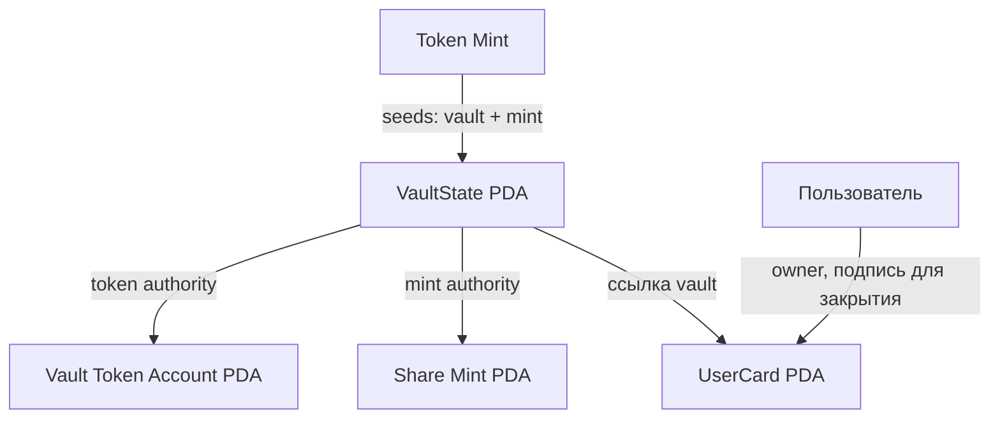
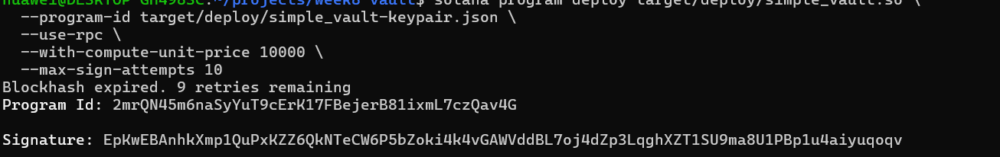
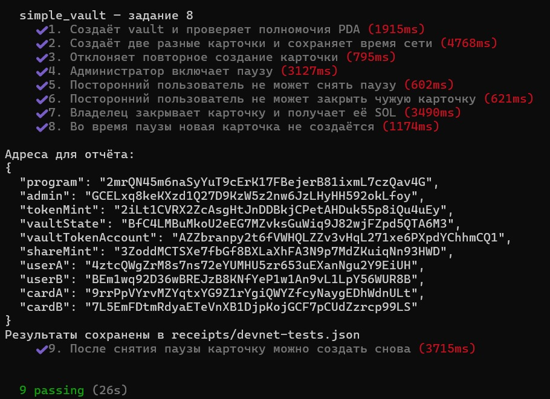

# Задание 8 — Simple Vault

Учебная программа на Solana с использованием Anchor 0.31.1.
Программа развёрнута и проверена в Devnet.

Основа проекта: [vault-dev, ветка students-vault-card](https://github.com/0xnurda/vault-dev/tree/students-vault-card).

## Что реализовано

В программе создаются настройки хранилища VaultState, токеновый счёт
хранилища, mint долевых токенов и отдельная карточка каждого пользователя.

В исходный проект добавлены три доработки:

1. В UserCard добавлено поле created_at. При создании карточки в него
   записывается время сети через Clock::get()?.unix_timestamp.
2. Добавлена инструкция close_user_card. Владелец может закрыть свою
   карточку и получить обратно SOL, которые обеспечивали хранение аккаунта.
3. В VaultState добавлен флаг paused и инструкция set_paused.
   Изменять флаг может только администратор. Во время паузы создание
   карточек запрещено. Закрытие собственной карточки остаётся доступным.

Это каркас хранилища: внесение депозитов, вывод токенов и начисление
доходности на данном этапе не реализованы.

## Схема аккаунтов



| Аккаунт | Seeds | Назначение |
|---|---|---|
| VaultState | `vault`, token_mint | Администратор, адреса аккаунтов, bump и paused |
| Vault Token Account | `vault_tokens`, token_mint | Токеновый счёт, управляемый VaultState PDA |
| Share Mint | `share_mint`, token_mint | Mint долевых токенов с authority VaultState PDA |
| UserCard | `user_card`, vault_state, user | Владелец, ссылка на vault, bump и created_at |

Размер VaultState с дискриминатором — 138 байт.
Размер UserCard с дискриминатором — 81 байт.

## Аккаунты в Devnet

| Аккаунт | Explorer |
|---|---|
| program | [2mrQN45m6naSyYuT9cErK17FBejerB81ixmL7czQav4G](https://explorer.solana.com/address/2mrQN45m6naSyYuT9cErK17FBejerB81ixmL7czQav4G?cluster=devnet) |
| admin | [GCELxq8keKXzd1Q27D9KzW5z2nw6JzLHyHH592okLfoy](https://explorer.solana.com/address/GCELxq8keKXzd1Q27D9KzW5z2nw6JzLHyHH592okLfoy?cluster=devnet) |
| tokenMint | [2iLt1CVRX2ZcAsgHtJnDDBkjCPetAHDuk55p8iQu4uEy](https://explorer.solana.com/address/2iLt1CVRX2ZcAsgHtJnDDBkjCPetAHDuk55p8iQu4uEy?cluster=devnet) |
| vaultState | [BfC4LMBuMkoU2eEG7MZvksGuWiq9J82wjFZpd5QTA6M3](https://explorer.solana.com/address/BfC4LMBuMkoU2eEG7MZvksGuWiq9J82wjFZpd5QTA6M3?cluster=devnet) |
| vaultTokenAccount | [AZZbranpy2t6fVWHQLZZv3vHqL271xe6PXpdYChhmCQ1](https://explorer.solana.com/address/AZZbranpy2t6fVWHQLZZv3vHqL271xe6PXpdYChhmCQ1?cluster=devnet) |
| shareMint | [3ZoddMCTSXe7fbGf8BXLaXhFA3N9p7MdZKuiqNn93HWD](https://explorer.solana.com/address/3ZoddMCTSXe7fbGf8BXLaXhFA3N9p7MdZKuiqNn93HWD?cluster=devnet) |
| userA | [4ztcQWgZrM8s7ns72eYUMHU5zr653uEXanNgu2Y9EiUH](https://explorer.solana.com/address/4ztcQWgZrM8s7ns72eYUMHU5zr653uEXanNgu2Y9EiUH?cluster=devnet) |
| userB | [BEm1wq92D36wBREJzB8KNfYeP1w1An9vL1LpY56WUR8B](https://explorer.solana.com/address/BEm1wq92D36wBREJzB8KNfYeP1w1An9vL1LpY56WUR8B?cluster=devnet) |
| cardA | [9rrPpVYrvMZYqtxYG9Z1rYgiQWYZfcyNaygEDhWdnULt](https://explorer.solana.com/address/9rrPpVYrvMZYqtxYG9Z1rYgiQWYZfcyNaygEDhWdnULt?cluster=devnet) |
| cardB | [7L5EmFDtmRdyaETeVnXB1DjpKojGCF7pCUdZzrcp99LS](https://explorer.solana.com/address/7L5EmFDtmRdyaETeVnXB1DjpKojGCF7pCUdZzrcp99LS?cluster=devnet) |

## Транзакции

| Действие | Explorer |
|---|---|
| Развёртывание программы | [Открыть](https://explorer.solana.com/tx/EpKwEBAnhkXmp1QuPxKZZ6QkNTeCW6P5bZoki4k4vGAWVddBL7oj4dZp3LqghXZT1SU9ma8U1PBp1u4aiyuqoqv?cluster=devnet) |
| Инициализация vault | [Открыть](https://explorer.solana.com/tx/5Mtb4MNt6vpsZTEmpb6eQp6bSqX3m5sToEbvr7n7X3c773Q9jj1jXtN7L36hVKyPLVgG2UAk7zct2Z9461VPSEz6?cluster=devnet) |
| Создание карточки A | [Открыть](https://explorer.solana.com/tx/645PZFW6eTg4iYyPegTSemZFFZAeEt9TdHhtFtQhsRQ73eemsntS9pvJ6jbfMx4vhNLFUihDbNw8h3eEas8EwvgR?cluster=devnet) |
| Создание карточки B | [Открыть](https://explorer.solana.com/tx/2MrNVxUkE96kK96xqKmyyMwtqQWyP67koVBCPNwGcr8xNpjaSvkcAXPc7BbwJHZMMcPjHLsXjtWnQwGk6zpMbkUi?cluster=devnet) |
| Включение паузы | [Открыть](https://explorer.solana.com/tx/33euCKHyziqYDYs6hSiSuWszLRte4B5i4yLAgyNLNfWTzW6dd7XPm6Zgra46XC4LBP2QiotJqE5pVHPsQWKHkkhy?cluster=devnet) |
| Закрытие карточки A | [Открыть](https://explorer.solana.com/tx/3VbSB6rEZYJeU3H9n9e7uxz1vfFCXdzDkiuer7ASdphf7o67s6ETgYGZJDkecF5E4VfsneHWDEqQw2PPBznkZQfg?cluster=devnet) |
| Снятие паузы | [Открыть](https://explorer.solana.com/tx/M9b2GKL7XEc9nNMYBrje8WfMWSKvZeHHL8msQkjY2QWiYFvF7Hv4RjQXTHgWvxVSq7MVknk28VzjuaQnHL88d5k?cluster=devnet) |
| Повторное создание карточки A | [Открыть](https://explorer.solana.com/tx/u3iPKxz98wccmEqxo615C9UL9UNP7jxf9Mf4D9muJa96Bu5faakZGGZaSFBoBjmEvZqxWoT9qttbtMs4qyL61aU?cluster=devnet) |

## Проверки

Сборка `anchor build` и проверка `yarn tsc --noEmit` выполнены успешно.
В Devnet прошли 9 тестов:

1. Создание vault и проверка полномочий PDA.
2. Создание отдельных карточек двух пользователей и проверка времени сети.
3. Запрет повторного создания существующей карточки.
4. Включение паузы администратором.
5. Запрет снятия паузы посторонним пользователем.
6. Запрет закрытия чужой карточки.
7. Закрытие карточки владельцем с проверкой возврата SOL.
8. Запрет создания карточки во время паузы.
9. Снятие паузы и успешное повторное создание карточки.

Итог запуска: **9 passing (26s)**.

Адреса и подписи успешных транзакций сохранены в
[receipts/devnet-tests.json](receipts/devnet-tests.json).
После проверок пауза выключена, карточки A и B существуют.

## Запуск

Необходимы Rust, Solana CLI, Anchor 0.31.1, Node.js и Yarn 1.

```bash
yarn install --frozen-lockfile
anchor build
yarn tsc --noEmit
```

Для тестов нужен кошелёк с тестовыми SOL в Devnet.
Укажите путь к нему и RPC Devnet в переменных окружения:

```bash
export ANCHOR_WALLET="$HOME/.config/solana/id.json"
read -r -s -p "Devnet RPC URL: " ANCHOR_PROVIDER_URL
echo
export ANCHOR_PROVIDER_URL
yarn run ts-mocha -p ./tsconfig.json -t 1000000 --exit tests/vault.ts
```

Тесты взаимодействуют с уже развёрнутой программой.
Каждый запуск создаёт новый тестовый mint и новый vault,
расходует тестовые SOL и обновляет receipts/devnet-tests.json.

При развёртывании собственной копии нужно создать свой program keypair,
выполнить `anchor keys sync`, заново собрать и развернуть программу.

## Скриншоты




